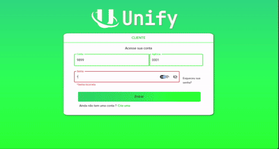

# Unify
 
This project is a banking interface that brings balance viewing and banking operations for different accounts together in a single environment. Instead of switching between multiple apps and portals, users can track and manage everything in one place.
 
The project is divided into four modules: **Backend**, **Database**, **Web**, and **Mobile**. The web project's home page is available at: <https://lovable.dev/projects/227388ec-7160-4ea1-b3bb-5faa46c875ba>
 

 
## Tech stack
 


 

 
## Running locally
 
Node.js is required. Clone the project
 
```bash
  git clone https://github.com/Caique27/Unify.git
```
 
Go to the project directory
 
```bash
  cd Unify
```
 
Start the JSON database (`Database` module, using [json-server](https://github.com/typicode/json-server))
 
```bash
  cd Database
  npx json-server db.json --port 3001
```
 
Start the Backend
 
```bash
  cd Backend
  npm install
  npm run backend
```
 
Start the Web application
 
```bash
  cd Web
  npm install
  npm run backend
```
 
Access the application at:
 
```bash
  http://localhost:3000/
```
 
<!-- TODO: confirm the file name (db.json), ports, and commands. Also add instructions for the Mobile module. -->
 
## Application demo
 


 
-   The user accesses a single dashboard, views the balances of their accounts, and performs banking operations without leaving the environment.
## Features
 
-   Balance viewing for different accounts in a single environment
-   Banking operations for each account
-   Web and Mobile applications
-   Separation between interface, API, and database
<!-- TODO: adjust the list to match the features actually implemented. -->
 
## Contact
 
Search by username or click the icons.
 
[](https://github.com/Caique27)
[](https://www.linkedin.com/in/caique-alves-/)

 
